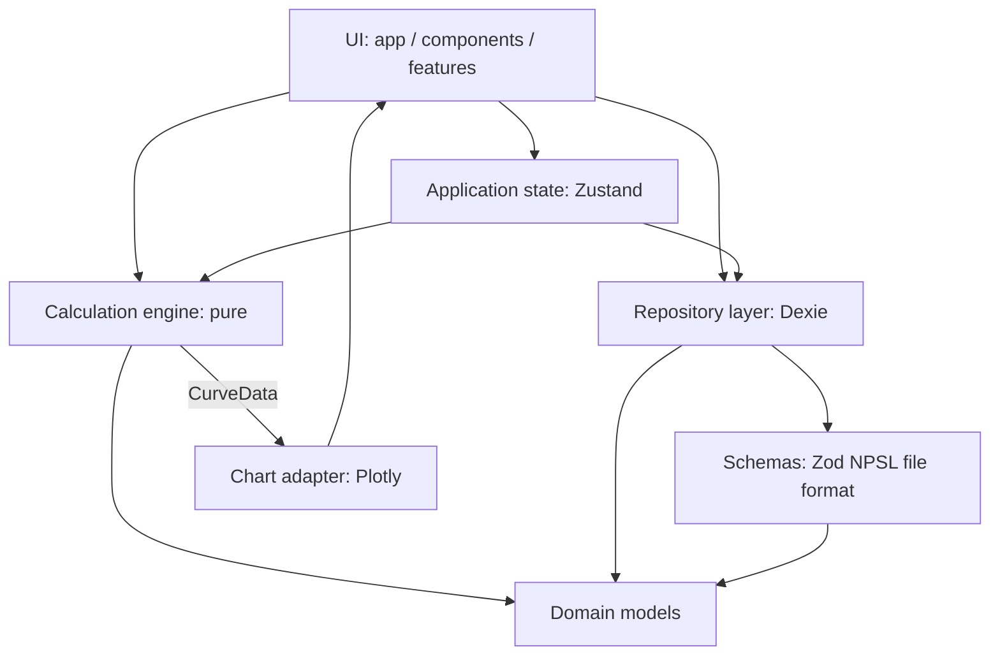

# Architecture

This document is the authoritative description of how Neuropharmacology
Sandbox is structured, how data and control flow through it, and which rules
must not be broken when extending it.

Related documents: [domain model](domain-model.md),
[calculation engine](calculation-engine.md), [provenance](provenance.md),
[NPSL format](npsl-format.md), [validation](validation.md),
[testing](testing.md), [decisions](decisions.md),
[spec review](spec-review.md).

---

## 1. Technology stack (finalized)

| Concern | Choice | Why |
| --- | --- | --- |
| Language | TypeScript (strict, `noUncheckedIndexedAccess`, `exactOptionalPropertyTypes`) | Scientific data types must be checked exhaustively |
| Build | Vite 8 | Fast, static output, no backend required |
| UI | React 19 | Spec requirement; ecosystem maturity |
| Styling | Tailwind CSS 4 + shadcn/ui (radix base) | Professional, restrained, accessible components |
| Icons | lucide-react | Consistent icon set; **emoji are never used as UI** |
| Routing | React Router 7 (central route table) | Spec requirement |
| State | Zustand (application state only) | Spec requirement; local state remains the default |
| Validation | Zod 4 | One validation language for files, inputs and config |
| Charts | Plotly.js behind a project-owned curve abstraction | Spec requirement; charts must never compute pharmacology |
| Numerics | Decimal.js | Deterministic decimal arithmetic for displayed results |
| Persistence | IndexedDB via Dexie.js | Local-first, offline, transactional imports |
| Unit tests | Vitest + React Testing Library | Fast, same transform pipeline as Vite |
| E2E | Playwright | Important user workflows end to end |
| Lint | oxlint | Fast, zero-config linting |

Deployment target: any static host (Cloudflare Pages, GitHub Pages). No
backend, no authentication, no cloud sync, no LLM.

---

## 2. Layer diagram

Strict top-down dependencies. A layer may only import from layers below it.

```
┌──────────────────────────────────────────────────────────────────┐
│  UI (React components, pages, charts)                            │
│  src/app/**  src/components/**  src/features/**                  │
└───────────────┬──────────────────────────────────────────────────┘
                │  props/events only, no formulas here
┌───────────────▼──────────────────────────────────────────────────┐
│  Application state (Zustand stores, one per feature)             │
│  src/features/<feature>/store.ts                                 │
└───────┬───────────────────────────────┬──────────────────────────┘
        │                               │
┌───────▼───────────────┐   ┌───────────▼──────────────────────────┐
│  Calculation engine   │   │  Repository / persistence            │
│  src/engine/**        │   │  src/data/repositories/**            │
│  pure functions       │   │  Dexie (IndexedDB)                   │
└───────┬───────────────┘   └───────────┬──────────────────────────┘
        │                               │
┌───────▼───────────────────────────────▼──────────────────────────┐
│  Domain models (types + invariants)                             │
│  src/domain/**  — drug, pharmacology, provenance, library, units │
└───────────────┬──────────────────────────────────────────────────┘
                │
┌───────────────▼──────────────────────────────────────────────────┐
│  Serialization / file formats                                    │
│  src/data/schemas/**  (Zod: NPSL file format; CSV maps onto it;   │
│  experimental dataset records), src/data/npex/** (versioned .npex) │
│  src/data/recovery/** (versioned .npsb all-store archive)          │
└──────────────────────────────────────────────────────────────────┘
```

Calculator input schemas are Zod too, but they are not an interchange
format: they live next to the calculator feature
(`src/features/calculator/schemas.ts`) and validate form drafts.
Experimental-dataset CSV mapping lives in `src/features/experiments/` but
reuses the shared RFC 4180 parser and validates against the same schemas.

Mermaid version:



### Layer rules (enforced by review + tests)

1. **UI** renders; it never contains pharmacological formulas, unit
   conversions or rounding rules. Components receive already-computed
   `CalculationReport` / `CurveData` objects.
2. **Application state** orchestrates (selection, drafts, async loading). It
   calls the engine and repositories; it does not reimplement their logic.
   Stores are per-feature, not a single global blob. The experimental-dataset
   page uses a feature-local React hook instead of a global store; its
   repository is injected from the app composition root.
3. **Calculation engine** is pure: no React, no Zustand, no IndexedDB, no DOM,
   no network, no ambient time or randomness. Same input → same output.
   (Enforced by review; a lint rule for forbidden imports is planned.)
4. **Domain models** are plain types plus small pure guards. They import
   nothing from layers above.
5. **Persistence** sits behind a repository interface
   (`getAllDrugs`, `getDrug`, `createDrug`, `updateDrug`, `deleteDrug`,
   `importLibrary`, `exportLibrary`; separately
   `ExperimentalDatasetRepository` for measured datasets). React never
   touches Dexie directly.
6. **Serialization** (NPSL/CSV/`.npex`/`.npsb`) lives in `src/data`, never
   inside components or the engine. Import/export can change without
   touching either.

### Why the data layer is independent

`src/data` depends on `src/domain` only. The engine never reads files or the
database; it accepts plain input objects. This is what makes the engine
independently testable and the library format replaceable.

---

## 3. Directory structure

```
src/
├── app/                     # application shell
│   ├── App.tsx              # RouterProvider
│   ├── routes.tsx           # central route table
│   ├── libraryStore.ts      # composition root: Dexie repository + Zustand store
│   ├── calculatorStore.ts   # composition root: calculator session store
│   ├── preferencesStore.ts  # composition root: preferences ↔ calculator wiring (phase 9B)
│   ├── dataSourcesStore.ts  # composition root: source-data repo (shared DB) + adapters (phase 18)
│   ├── experimentDatasetRepository.ts # composition root: Dexie dataset repository (phase 47A)
│   ├── layout/              # AppLayout, PageHeader
│   └── pages/               # route-level views (thin; delegate to features)
├── components/
│   ├── ui/                  # shadcn/ui primitives (generated, treat as vendor code)
│   ├── charts/              # CurveData -> Plotly adapter + lazy chart component (phase 4);
│   │                        # simulationAdapter + SimulationChart (phase 42);
│   │                        # experimentalDatasetAdapter + marker-only chart (phase 47A)
├── features/                # one folder per feature
│   ├── drug-library/        #   list/detail/form views (phase 3)
│   ├── calculator/          #   model adapter registry, input drafts, session store,
│   │                        #   CalculatorView (phase 4)
│   │   ├── schemas.ts       #   Zod structural validation of form drafts
│   │   ├── store.ts         #   drafts, report, stale flags, curve settings
│   │   └── components/      #   ParameterField, ResultPanel, CalculationTrace,
│   │                        #   VisualizationPanel, ErrorPanel, ProvenanceBadge
│   ├── simulation/          #   demo scenario, session runner, SimulationView (phase 42)
│   │                        #   ephemeral: component state only, nothing persisted
│   ├── experiments/         #   measured dataset page, CSV mapping/validation,
│   │                        #   .npex import, repository-backed hook (phase 47A)
│   ├── import-export/       #   import/export UI (phase 5)
│   │   ├── csv/             #   RFC 4180 reader/writer, stable CSV schema,
│   │   │                    #   explicit mapping -> versioned NPSL document
│   │   ├── ImportPanel.tsx  #   file -> preview -> confirm -> report flow
│   │   ├── CsvMappingCard.tsx #  explicit column mapping + fixed-unit policy
│   │   ├── ExportPanel.tsx  #   whole-library .npsl/.json/.csv downloads
│   │   └── fileIo.ts        #   readTextFile, downloadTextFile (object URLs)
│   └── data-sources/        #   on-demand retrieval UI (phase 18)
│       ├── store.ts         #   session store: search/fetch/cancel/import/apply
│       ├── DataSourcesView.tsx #  picker → results → measurements → confirm import
│       ├── StoredDataPanel.tsx #  offline stored records + Layer C apply form
│       └── ObservationSummary.tsx # shared measurement row (value + qualifier + provenance)
├── domain/                  # pure domain types and guards
│   ├── drug/                #   Drug, ReceptorTarget, TargetSourceReference, Pharmacokinetics
│   ├── pharmacology/        #   ScientificValue, units + unit catalog
│   ├── provenance/          #   Provenance union + guards
│   ├── sources/             #   Layer A compound + Layer B observation (phase 18)
│   ├── experiments/         #   ExperimentalDataset + ExperimentalMeasurement (phase 47A)
│   └── library/             #   DrugLibrary, LibraryMetadata
├── engine/                  # pure calculation engine (all 3 MVP models implemented, phase 2)
│   ├── types.ts             #   CalculationReport, trace, CurveData contracts
│   ├── index.ts             #   public API barrel
│   ├── registry.ts          #   ModelDescriptor registry (labels, formulas, assumptions)
│   ├── input.ts             #   engine input types (one per model)
│   ├── numeric/             #   Decimal helpers: 12-digit report rounding, loss detection
│   ├── validate/            #   shared input validation → typed CalculationError
│   ├── units/               #   dimension checks + unit conversion used by models
│   ├── trace/               #   helpers to build calculation traces
│   ├── curve/               #   chart-agnostic range validation + x-sampling
│   ├── pk/                  #   first-order one-compartment model + curve generator
│   ├── occupancy/           #   single-site binding model + curve generator
│   ├── dose-response/       #   Hill equation + curve generator
│   └── simulation/          #   dynamic simulation (phase 41): ODE solver, events,
│                            #   two-compartment IV model, orchestrator, SimulationReport
├── data/
│   ├── schemas/             # Zod schemas (NPSL file format; CSV builds an NPSL document first)
│   │                        # sources.ts: loose record schemas for imported source data (phase 18)
│   │                        # experimentalDatasets.ts: dataset input/record/.npex shapes (phase 47A)
│   ├── npex/                # versioned single-dataset .npex parse/build (phase 47A)
│   ├── recovery/            # versioned .npsb all-store archive, fidelity scan, restore (phase 8B; 47A store extension)
│   ├── db/                  # single versioned Dexie module + upgrade hooks (phase 3; v3 adds
│   │                        # `compounds` + `observations`, v5 `scenarios`, v6 `experimentDatasets`)
│   ├── mappers/             # persistence DTO <-> domain, NPSL export document
│   ├── import/              # NPSL parse -> schema -> semantic -> preview pipeline
│   ├── sources/             # HTTP transport, PubChem/ChEMBL adapters, registry (phase 18)
│   ├── id.ts                # stable id helpers
│   └── repositories/        # repository interfaces + Dexie implementations (phase 3;
│                            # sourceDataRepository phase 18; experimental dataset repository phase 47A)
├── tests/
│   ├── setup.ts             # Vitest setup (jest-dom matchers)
│   ├── report.ts            # shared report assertion helpers
│   ├── fixtures.ts          # synthetic, explicitly-marked test fixtures
│   └── fixtures/            # example NPSL library (marked example data)
│       └── sources/         # checked-in PubChem/ChEMBL response fixtures (phase 18)
└── ...
e2e/                         # Playwright specs: shell, calculator, import/export,
                             # library persistence, keyboard workflows, accessibility scans
docs/                        # this documentation
```

Adjusting folder names is fine; the **separations** are not negotiable:
`domain`, `engine`, `data`, `features`, `components`, `app`.

---

## 4. Data flows

### 4.1 Application start

```
IndexedDB (Dexie)
   → repository.getAllDrugs() + metadata
   → schema/migration validation        (never silently discard data)
   → Zustand store hydration
   → UI render
```

### 4.2 Modification (create / edit / delete)

```
user action
   → Zod validation of the draft (calculator inputs, drug form)
   → domain invariants checked
   → Dexie transaction (atomic)
   → Zustand state update
   → UI re-render
```

A failed validation leaves both IndexedDB and application state untouched.

Editing an existing record also preserves data the form does not expose:
the supported target-level metadata (`gene`, `action`, `species`, `notes`)
of every surviving target is reattached by stable target id when the
submitted target list is built, and the stored-only recognized identifier
fields (`description`, `casNumber`) are reattached from the record itself,
so an unrelated edit never silently deletes either group, a removed
target's metadata leaves with it, and fields a record never had stay
absent. The four directly edited fields — name, synonyms, tags and
top-level notes — submit their stored values verbatim whenever their
draft text is still at its mount-time baseline (audit DI-03): embedded
commas, duplicate entries and edge whitespace inside a field the user
never touched survive an edit exactly, including the `notes`
present/absent distinction. Only a field the user actually changed is
parsed (comma-split, trimmed, de-duplicated) or trimmed; the
comma-delimited input still cannot represent an individual list entry
containing a comma *while that list is edited* — a documented
limitation, with no escaping syntax or new widget. Parameter values are
likewise resolved by source identity: a value draft still reading the
source's own textual representation submits the stored number verbatim,
so a negative-zero value (`-0`, displayed as `"0"`) keeps both its sign
and its complete provenance through an unrelated edit (audit DI-04) —
and the shared NPSL serializer emits the numeric JSON token `-0`
(collision-proof placeholder) so the sign survives export → import; no
global ±0 equivalence is introduced. The submitted
`targets` array still replaces the stored list
wholesale and `identifiers` still carries the form's `name`/`synonyms`
(the repository contract is unchanged), and this adds no editing controls,
no schema field and no interchange format change.

#### Multi-tab write semantics (phases 19–20 — audit GAP-4)

Phase 19 confirmed the defect in a real browser and documented it as a
limitation; phase 20 remediated it with optimistic concurrency. Two
layers, verified separately in repository tests and in a real two-tab
browser test; they must not be conflated.

**1. Revision tokens (phase 20).** Every drug record carries a
monotonic per-id revision token, stored in the Dexie `revisions` table
(`{ id, revision }`; an absent row means `0`) — never inside the drug
row itself, so stored rows, NPSL documents and `.npsb` archives stay
byte-clean of it (`Drug.revision` is read-only bookkeeping the
repository attaches on `getAllDrugs`/`getDrug` — which read drugs and
revisions in ONE read transaction, so a token always matches the row it
was read with — and strips before any row/record/export write).

- `updateDrug(id, changes, expectedRevision)` compares the token and
  writes **inside one read-write transaction** over drugs, metadata and
  revisions: a matching token commits and bumps the revision in the
  same transaction as the data write; a stale token rejects before any
  write with a typed `RepositoryError('CONFLICT')` (alongside
  `NOT_FOUND`, `VALIDATION`, `STORAGE`) and alters nothing — there is
  no compare-then-write window for a second writer to slip through
  (repository tests: stale rejection leaving row, revision and
  metadata byte-identical; two concurrent writers — one connection and
  two connections — cannot both commit; a fresh token succeeds).
- Every path that writes drug rows — `createDrug`, `importLibrary`
  (merge and replace), `replaceLibrary`, `restoreRecoveryArchive` —
  bumps every id it writes inside its own transaction; `deleteDrug`
  keeps the revision tombstone, so delete→recreate, restore and import
  can never revive a stale form's token (ABA-safe). `DrugChanges` merge
  semantics for omitted groups are unchanged (see below), and
  validation/uniqueness failures stay distinguishable from conflicts by
  error code — a validation-rejected write does not advance the
  revision.
- **Deletion is revision-guarded (phase 20 review fix).**
  `deleteDrug(id, expectedRevision)` compares the token with the stored
  revision INSIDE the deletion's own read-write transaction
  (drugs+meta+revisions): a stale token rejects with `CONFLICT` before
  anything is deleted or stamped — a detail page that loaded before
  another tab's commit can never delete the newer record (repository
  tests; `e2e/multitab.spec.ts` scenario 3). A successful delete keeps
  the tombstone and deliberately does NOT advance it — deletion is the
  absence of data, not a content mutation, and with the row gone every
  stale action already fails `NOT_FOUND`; concurrent deletes cannot
  both succeed because the loser's transaction re-reads the
  post-delete state (`NOT_FOUND`, never a masked conflict for a record
  that still exists). In the UI, a delete conflict renders a distinct
  alert ("Deletion did not happen… the record changed elsewhere"),
  keeps the record's detail view open and locks the delete action
  behind an explicit reload — the destructive confirmation step is
  unchanged, and nothing retries automatically (`DeleteDrugResult` in
  `store.ts`).
- The write gate is the repository: application code reaches storage
  only through the injected instance. A hypothetical direct Dexie write
  would neither compare nor bump — a documented bypass for which no
  path exists in app code.

**2. The repository API (`DrugChanges`) — per-call merge against a
fresh read.** `updateDrug` applies `changes` to the row re-read inside
the transaction (`dexieDrugRepository.ts` `applyChanges`):

- A group absent from `changes` (`identifiers`, `tags`, `targets`,
  `pharmacokinetics`, `notes`) keeps the freshly read value — an API
  caller that omits groups therefore composes with a write another
  connection committed in between (repository test: "composes an
  omitted group with an interleaved committed write").
- A supplied group replaces the stored group **wholesale**:
  `identifiers` and `targets` are replacement groups, never deep-merged
  — fields the replacement omits do not survive (repository test:
  "replaces a supplied group wholesale").
- `notes` is the one key where presence carries a second meaning:
  absent keeps the stored value, an explicit `undefined` clears it.
- Every committed update restamps `updatedAt`; `createdAt`, origin and
  unknown extension fields are preserved.

This per-call merge composes only for groups the caller omits — it is
not a substitute for the token check, which is what makes a *stale*
full-snapshot write impossible rather than merely unlikely.

**3. The edit form submits a full snapshot, not a delta.**
`DrugForm.buildInput` always emits all four editable groups —
`identifiers`, `tags`, `targets`, `notes` — even when the user changed
only one of them: untouched fields submit the values of the record as
it was when the form mounted. `pharmacokinetics` is the only group the
form never emits, so it alone survives via the repository's re-read.
The form captures the record's revision once, at mount, and submits it
unchanged; it never re-reads or auto-refreshes the token, so a save
whose draft is based on a superseded record state always conflicts
instead of silently composing.

**Conflict handling in the UI (phase 20).** `store.updateDrug` returns
a discriminated `UpdateDrugResult` (`ok` / `conflict` / `error`); a
conflict is a per-session outcome and does not touch the session error
banner. In the edit form a conflict renders a distinct alert ("Record
changed elsewhere") while the form stays open with the draft intact,
offering exactly two explicit recovery paths: open the latest record
in a new tab (draft kept) or reload the record (draft discarded,
labeled as such). Dismissing the alert keeps the draft — and the stale
token — so re-saving the same draft conflicts again until the user
re-bases on the current record. There is no automatic retry, no false
success, and target identity, provenance and source references are
preserved verbatim by the winning commit and the recovery flow
(`e2e/multitab.spec.ts` asserts both).

**Phase 19 history (observed defect, now remediated).** Before the
token check, the same two-tab interleaving silently reverted newer
data: a stale tags-only save reverted a committed rename, and a stale
name-only save reverted a committed parameter edit wholesale (targets
group) — both reporting success with no error (audit GAP-4; pinned as
a limitation in phase 19, replaced by the conflict contract in phase
20). Cross-tab *display* refresh is still none — a tab refreshes its
Zustand session only after its own mutations or a manual
hydrate/reload (`store.ts` `refresh`, `AppLayout.tsx`); there is no
storage event, live query, `BroadcastChannel` or focus/visibility
re-hydration. That is now safe by design: a stale *display* is
corrected at the next interaction, and a stale *write* is rejected via
the conflict flow instead of being silently applied.

### 4.3 Calculation

```
Calculator draft (Zustand, per model; PK mode is a discriminant)
   ↓
Zod structural validation           (presence, finite number, unit present —
                                     never a scientific rule)
   ↓
model adapter                       (draft → engine input; provenance only
                                     from an explicit library load)
   ↓
scientific engine                   (pure; the single scientific authority)
   ↓
CalculationReport
     ok: true  → inputs, formula, trace, outputs, assumptions, warnings
     ok: false → CalculationError[] (rendered verbatim, mapped to fields)
   ↓
result panel + calculation trace    (UI; no formula is recreated there)
   ↓  explicit range + "Update curve" — never automatic
CurveData                           (engine sampling; warnings attached,
                                     point data never altered)
   ↓
chart adapter                       (CurveData → Plotly traces/layout;
                                     never computes pharmacology)
   ↓
Plotly chart (lazy-loaded)
```

No layer between the draft and the engine applies a scientific rule, and
no layer after the engine alters curve data — axis fallbacks change the
display only (see ADR-16).

### 4.3a Dynamic simulation (phase 41)

The simulation core is a second, independent boundary of `src/engine`; it
shares the purity rules and reporting helpers, not the scalar report shape.

```
SimulationScenario (start/end, output grid, initial amounts, parameters
                  with units, dosing events, explicit solver settings)
   ↓  validate scenario + solver settings        → typed SimulationError[]
   ↓  convert every quantity to canonical units  (declared + canonical kept)
   ↓  validate/order/group dosing events         (stops → boluses → starts)
   ↓  initialise physical + accounting states    (A_e = A_in = 0, ADR-25)
   ↓  boundary list = output times ∪ event times ∪ end time
   ↓  adaptive Dormand–Prince 5(4) to each boundary, clipped exactly
   ↓  emit pre-event / interval / post-event samples
   ↓  apply the event group, invalidate the FSAL cache, continue
   ↓  invariants: finiteness, non-negativity, mass balance
   ↓
SimulationReport
     ok: true  → samples, event trace, infusion steps, solver diagnostics,
                 normalized parameters, mass-balance summary, warnings
     ok: false → SimulationError[] (stage, field, event id); no samples
```

Dependency direction is unchanged: the simulation imports `src/domain`
(units/catalog) and its own `src/engine` helpers, and nothing above it. No
UI, store, database or chart module is involved in this phase; a chart
adapter can later consume `samples` directly (ADR-24 fixes the pre/post
semantics it must honour).

### 4.3b Simulation visualisation (phase 42)

```
SimulationDraft (blank scientific/time inputs, technical solver defaults)
   ↓  user supplies a complete scenario and presses "Run simulation"
simulate()  ← the Phase 41 engine: the ONLY source of every displayed number
   ↓ SimulationReport (ok / structured errors; failures carry no samples)
simulationAdapter (pure: sampled values copied in emission order,
                   concentrations and amounts to SEPARATE charts)
   ↓ SimulationChart descriptors (chart + event markers)
SimulationChart (Plotly, lazy)   +   event table   +   diagnostics
```

The fixed `DEMO_SCENARIO` is retained as a test fixture only; it is not loaded into the product UI. The simulation feature follows the same dependency rules as the calculator:
the page owns an ephemeral session (component state, no Zustand store, no
IndexedDB, no network) and the chart layer performs no calculation. A
dosing event keeps its two same-time samples (`pre-event`, `post-event`), so
a bolus is drawn as a vertical jump rather than smoothed into an interval
(ADR-26). Errors replace results — a failed or unreportable run leaves no
chart on screen.

**Chart sizing (phase 44).** `SimulationChart` owns its Plotly size: the
container is a `min-width: 0` grid cell with a deliberate height (320 px,
260 px below 640 px width), the layout declares `autosize: false` with the
measured width and height, and a `ResizeObserver` relays out on container
changes. Before this, Plotly fell back to its 450 px default inside a
360 px fixed-height box and spilled over the note, event table and
diagnostics below it. Results show one analysis view at a time
(concentration, amount, infusion rate) selected through a radio-group
switcher; switching is presentation only and never calls the engine.

### 4.3c Editable scenario (phase 43)

```
SimulationDraft   (strings; blank stays blank; rows keyed by a stable integer)
   ↓ compileScenario()   pure: parse + build the output grid + map rows to events
   ├─ draft errors → form summary + field messages (engine NOT called)
   └─ SimulationScenario snapshot
          ↓ simulate()  (explicit Run only — never on render or typing)
   SimulationReport  → adapters → charts / event table / diagnostics
```

One infusion row compiles to an `infusion-start` + `infusion-stop` pair that
share an `infusionId`; the engine alone decides ordering and rate summing.
Any draft edit clears the previous result, so a displayed chart always
belongs to the draft that produced it. Chart visibility toggles live in
separate presentation state and never invoke the engine. The report →
chart mapping is unchanged from §4.3b (ADR-26); the editor adds no
calculation (ADR-27).

### 4.3d Saved scenarios (phase 45)

```
SimulationView (draft state)  ──passed as a prop──▶  SavedScenariosPanel
        │                                                    │
        │                        useScenarioLibrary (workflow: list, loaded id,
        │                        dirty guard, busy, feedback)
        │                                                    │
        ▼                                                    ▼
  draft state                             ScenarioRepository (Dexie)
  result cleared on load                   v5 `scenarios` table, same
                                           database and `.npsb` snapshot
```

- **Layering.** The panel renders state and collects intent; the
  `useScenarioLibrary` hook orchestrates the workflow; `DexieScenarioRepository`
  owns persistence. The page injects the repository from the app composition
  root (`src/app/scenarioRepository.ts`), so components never import the
  database module and tests inject an in-memory double.
- **Saved scenarios are named copies of the draft**, not results: the whole
  `SimulationDraft` (string fields, row keys, units, solver settings) is
  stored verbatim, including blank or unparseable values. No samples, charts
  or diagnostics are persisted.
- **Data management never simulates.** Saving, loading, renaming,
  duplicating, deleting and refreshing call only the repository; `simulate()`
  runs solely from the explicit Run action. Loading replaces the draft and
  clears any previous result through the existing invalidation path.
- **Guards.** Loading over a draft with unsaved edits parks the request and
  asks for confirmation; cancelling (or Escape) keeps the draft. Dirty state
  is a deterministic JSON snapshot comparison against the loaded/saved
  baseline (never object identity); a draft that was never loaded or saved
  counts as unsaved once edited.
- **Deletion** is an inline confirmation naming the scenario and stating
  that the editor draft is not affected; Escape cancels and focus returns.
### 4.3e Optional effect-site and receptor occupancy (phase 46)

```
SimulationScenario.effectSite?  ──resolveEffectSite()──▶  validated f_u, k_e0, K_d
        │                                                  (unit conversion + provenance)
        ▼
  simulate()  ── PK samples (existing, unchanged) ──▶ propagateEffectSite()
        │                                                  │
        ▼                                                  ▼
  result.samples[i] ◀── 1:1 aligned ──▶ result.effectSite.series[i]
                                       { Ce, occupancy, time, side, eventGroup }
```

- **Opt-in and additive.** `effectSite` is optional on both the scenario and the
  result. Absent means PK-only: no key is added, samples keep their shape, and
  every PK value is identical to a run without the feature.
- **Derived, not integrated.** Ce is NOT a fifth physical ODE state. It is
  post-processed from the emitted PK samples, so it never enters the state
  vector, `initialState`, cumulative input or the mass-balance residual.
- **Equations.** dCe/dt = k_e0·(f_u·Cc − Ce) and Occupancy = Ce/(Ce + K_d). Ce
  starts at equilibrium with the PRE-EVENT central concentration at startTime
  (Ce(0) = f_u·Cc), so a bolus at that time changes Cc but not Ce or occupancy.
- **Numerical contract.** Between emitted samples the unbound concentration is
  reconstructed as piecewise linear and Ce is propagated with the exact
  solution of that reconstruction (stable `expm1`/series evaluation for small
  k_e0·h). This is exact for the reconstruction — not for the true continuous PK
  trajectory and not identical to jointly integrating both ODEs.
- **Units and provenance.** K_d must be a concentration compatible with the
  model concentration; a molar K_d needs an explicit molecular weight (g/mol)
  with provenance. Ki, IC50 and EC50 are never substituted for K_d.
### 4.3f Experimental datasets (phase 47A)

```
CSV file ──parseCsv──▶ explicit mapping + units ──validate each row──▶ preview
.npex file ──version/size/duplicate-key checks──▶ strict schema ──────▶ preview
                                                                    │
                                                          explicit confirmation
                                                                    ▼
                                           ExperimentalDatasetRepository.create()
                                                    validation again, ids,
                                                    one Dexie transaction
                                                                    │
                                                                    ▼
                                           v6 experimentDatasets store
                                                                    │
                              ┌─────────────────────────────────────┴────────────┐
                              ▼                                                  ▼
                    ordered measurement table                       marker-only Plotly chart
                    (accessible authority)                          (declared units, no fit)
                                                                    │
                                                export one dataset ─┴─▶ `.npex` 1.0.0
```

- **Separate model and stores.** Experimental datasets never reuse the
  source-data `ExperimentalObservation` type, never enter the drug library,
  and never change NPSL. The v6 `experimentDatasets` store is additive.
- **Explicit import.** CSV columns and both units are selected by the user;
  no header, filename or value magnitude is inspected to infer them. `.npex`
  carries both units and a strict, independently versioned envelope. Every
  preview is read-only; only confirmation calls the repository, which
  validates again inside its transaction.
- **Measured data stay measured.** Source order, duplicate timestamps,
  exact replicates and sample ids are retained. No averaging, sorting,
  deduplication, interpolation, unit conversion or fitted curve is performed
  anywhere in this flow. `sourceRow` is provenance, never a database key.
- **Atomic, validated persistence.** `list`/`get` validate stored rows on
  read and report unreadable ones without deleting them. `create`, `update`
  and `delete` use single-store transactions; `update` and `delete` compare
  the caller's `updatedAt` token inside the transaction, so a stale view
  cannot silently replace a newer name or delete a newer dataset. Only name
  and notes are mutable; units, measurements and provenance are immutable.
- **Presentation-only visualization.** The chart adapter maps stored
  measurements verbatim to one marker trace. React and Plotly perform no
  scientific calculation. The measurement table is always rendered and is
  the accessible source of every value.
- **Recovery.** `.npsb` 1.1.0 snapshots and restores all six persistent
  stores, including `experimentDatasets`, in the same atomic full-replacement
  transaction; older archives are still restorable with explicit warnings
  that absent stores will be cleared. `.npex` remains the portable
  single-dataset interchange format.

See [experimental-data.md](experimental-data.md) for the full contract and
ADR-28 for the separation decision.

### 4.4 Import (all-or-nothing)

```
file (.npsl / JSON / CSV)
   → read & JSON/CSV parse (CSV: RFC 4180, line-numbered errors)
   → CSV only: explicit column mapping + declared unit policy → a
               versioned NPSL document (no value is ever inferred)
   → version compatibility check
   → Zod schema validation           (src/data/schemas)
   → semantic validation             (units, duplicates, provenance rules)
   → preview (counts, warnings, per-record status; CSV declarations)
   → user confirms   (replace additionally requires an acknowledgement)
   → single Dexie transaction writes the library
   → on any error: abort → existing library unchanged
```

The UI (phase 5, `src/features/import-export/`) owns only presentation
and confirmation: file selection and preview are read-only, and the
single write path is the store's `importLibrary` → repository transaction
(same pipeline, re-validated inside the transaction).

Two follow-up rules keep import outcomes and forward compatibility honest:

- **Commit vs. refresh.** The store separates the transaction from the
  session re-read that follows it. `ok` and `committed-refresh-failed`
  both mean the records are in the database; the latter carries the
  original refresh error, leaves the session visibly stale, and offers a
  hydrate retry — a committed import is never reported as a rollback and
  never re-run automatically. `invalid`/`failed` mean nothing was written.
- **Extension (unknown-field) preservation.** Unknown keys accepted by
  the loose schema are written from the incoming file (replace and
  first-time merge) and kept from storage when the file never mentioned
  them; a collision is won by the incoming file. Metadata extensions
  survive a replace via `resolveLibraryMetadata`; merge never touches
  library metadata. Envelope-level extras have no storage location and
  surface as warning `ENVELOPE_FIELDS_DROPPED`
  (details: `docs/npsl-format.md` §6).

### 4.5 Export

```
repository exportLibrary()
   → validated records only    (quarantined records are excluded — the UI
                                shows an explicit notice with the count)
   → NPSL serializer (preserves provenance, metadata, versions, extensions)
   → file download          .npsl / .json  (lossless for records, provenance
                                             and extensions; envelope-level
                                             extras are never stored — see §4.4)
   → CSV projection         (lossy; provenance flattened to columns, text
                             cells formula-guarded with a leading
                             apostrophe — validation.md §7 and spec-review.md §6)
```

None of these three exports is a complete storage snapshot: quarantined
raw rows are excluded from all of them and the UI announces the excluded
count, so ordinary exports must never be presented as full backups. The
full-storage format is the separate `.npsb` recovery archive (phase 8 —
[recovery-backup.md](recovery-backup.md), ADR-18): the contract was
designed in 8A and export/restore is implemented and verified in 8B
(`src/data/recovery/`, the repository/store restore paths, the Recovery
tab). Ordinary exports remain interchange-only, as above.

### 4.6 Calculator state (session-only)

The calculator store is transient UI state; it never touches IndexedDB
(the library remains the source of truth) and it holds only these
architectural guarantees:

```
Calculator Zustand store
├── draft                active model + its inputs (PK mode discriminant)
├── report               last CalculationReport (null | ok | failed)
├── stale                inputs changed since `report` was calculated
├── curve                last CurveData for the explicit range (else null)
├── curveSettingsStale   range/scale settings changed since `curve` was
│                        generated — an old curve is never presented as current
└── settings             per-model curve settings: explicit range, points,
                         x/y scales (session state — the *saved defaults*
                         live in the preferences store, §4.7, and are
                         applied to this store at startup)
```

`stale` and `curveSettingsStale` are independent on purpose: editing an
input does not claim the curve is out of date with respect to its
settings, and changing the range does not claim the numeric result is
out of date with respect to its inputs.

### 4.7 Application preferences (device-local, phase 9B)

`/settings` manages two kinds of *presentation* preference, stored in
**one versioned `localStorage` record** (key
`neuropharmacology-sandbox.preferences`, structure
`{version: 1, theme, calculator: {settings}}`; ADR-19) — deliberately
outside IndexedDB so the scientific storage schema and record formats
stay untouched:

- **Theme** — `system | light | dark` (documented default: `system`,
  which follows the operating system). The effective choice is applied
  as the `.dark` class on the document root — the existing
  `@custom-variant dark` convention, one mechanism, one writer —
  synchronously at startup from `main.tsx`, before the first render, so
  the app paints in the chosen theme. System mode follows
  `prefers-color-scheme` live; a manual Light/Dark choice is never
  overridden by a later OS change.
- **Calculator display defaults** — the per-model curve settings
  (`Record<ModelId, CurveSettings>`: explicit range, points, x/y scales)
  each model starts with. The defaults themselves are defined exactly
  once, in `features/calculator/store.ts`
  (`defaultCalculatorSettings()`); the persisted copy is validated with
  Zod **and** the engine's own `validateCurveOptions`, then pushed into
  the calculator session store at startup (`applyPresentationSettings`)
  and on every Settings change. Curve ranges and axis scales are
  presentation configuration — the chart never computes pharmacology —
  so nothing scientific is stored here.

Boundary: **preferences never hold scientific state.** Input drafts,
reports, curve data, drug records and provenance are not read or written
by the preferences layer, and the scoped "Reset application
preferences" action restores only the theme and the calculator display
defaults.

Failure handling: malformed JSON, invalid values and unsupported
versions are discarded wholesale in favour of the documented defaults
(announced in a `role="status"` note); a browser that denies storage
runs from in-memory defaults with the same note. Range fields accept
only blank-or-finite non-negative numbers (points: blank or an integer
in the engine's 2–5000 bounds), and a fully entered range must satisfy
the engine's cross-field rules before it is stored — invalid text stays
visible next to its message and is never persisted.

### 4.8 On-demand source retrieval (phase 18)

```
user searches a source (explicit query + scope)
   → adapter builds one bounded request (10 s timeout, one retry on
     network/5xx) → response validated with Zod at the network edge
   → normalized Layer A (compound) / Layer B (observation) records
   → session store (transient; stale/cancel guards via monotonic seq +
     AbortController)
   → user selects individual records → preview (advisory counts)
   → explicit confirm → sourceDataRepository.importSourceRecords:
     one Dexie rw transaction — validate every record again at the
     repository boundary, write only rows whose deterministic id
     (`source:recordId`) does not exist (existing records win, skips are
     reported), reject the whole batch if any record fails
   → hydrateStored refreshes the offline panel
```

Applying a stored observation onto a drug parameter (Layer C) is a
separate one-way path: `applyObservation` checks endpoint→slot mapping,
exact qualifier, a molar-concentration unit and an explicit overwrite
for occupied slots, then `drugRepository.updateDrug` writes the drug with
a `literature` provenance carrying `observationId` — validated against
the drug's current revision token (phase 20 optimistic concurrency; a
stale token surfaces as a failed apply, never an overwrite), and the
parameter stays traceable back to the source record. Mounting the page performs zero
network requests; nothing is ever downloaded, synced or seeded
automatically (see `docs/data-sources.md`).

---

## 5. Routes

| Path | View | Phase |
| --- | --- | --- |
| `/` | redirect → `/library` | 1 (done) |
| `/library` | Drug Library (list, filter, quarantine report, create entry point) | 3 (done) |
| `/library/new` | New Drug Record (create form, explicit units) | 3 (done) |
| `/library/:drugId` | Drug Detail (targets, read-only PK, provenance, edit/delete, Calculate link) | 3 (done) |
| `/calculator` | Calculator — **implemented**: model selector, input forms, results, calculation trace, curve controls + charts | 4 (done) |
| `/simulation` | Simulation — **implemented**: editable scenario, dynamic PK simulation, saved scenarios, effect-site analysis, charts and diagnostics | 42–46 (done) |
| `/experiments` | Experimental Datasets — **implemented**: CSV/`.npex` import, saved datasets, ordered measurements, observed + fitted chart, residual plot/RMSE, preliminary data-support screen, rename/delete, `.npex` export | 47A–47C (initial diagnostics slice) |
| `/data-sources` | Data Sources — **implemented**: PubChem/ChEMBL search, measurements fetch, preview → confirm import, stored records, Layer C apply | 18 (done) |
| `/import-export` | Import / Export — **implemented**: NPSL/JSON/CSV import and export, plus the `.npsb` Recovery tab | 5, 8B (done) |
| `/settings` | Settings — **implemented**: theme, per-model curve display defaults, data-management links, About, scoped preference reset | 9 (done) |
| `*` | Not found | 1 (done) |

Every route has a page in `src/app/pages/` so routing, layout and
navigation are wired and tested; `/import-export` delegates to the
phase-5 import/export feature and its phase-8B Recovery tab, `/simulation`
delegates to the phase-42–46 simulation feature, `/experiments` to the
phase-47A measured-dataset feature, and `/settings` (phase 9B) manages
device-local presentation preferences — see §4.7.

---

## 6. Roadmap (aligned with the MVP priority order)

| Phase | Deliverable | Depends on | Status |
| --- | --- | --- | --- |
| 1 | Architecture, domain types, NPSL schema + tests, app shell, test harness | — | done |
| 2 | Calculation engine models (PK, occupancy, Hill) + unit catalog + full unit tests + hardening (log y-axis validation, consistent numerical-loss policy, invariant coverage, CI) | 1 | done |
| 3 | Drug library: Dexie repository, IndexedDB schema + migrations, startup hydration, transactional NPSL import, minimal library UI | 1, 2 | done |
| 4 | Calculator + scientific visualization: model selector, explicit parameter inputs with provenance-aware library loading, results with calculation traces, CurveData → Plotly chart adapter, linear/log controls, log-Y representability handling, curve settings state — plus the hardening pass (PK mode union fix, stale-state semantics, curve readiness separation) and the critical calculator E2E workflows | 2, 3 | done |
| 5 | Import/export UI (.npsl, JSON, CSV with field mapping) + round-trip tests | 3 | done |
| 6 | Accessibility, keyboard workflows and library persistence E2E: semantic headings/landmarks/page titles, skip link with focus placement, accessible names and announced errors (`aria-invalid` / `aria-describedby` / `role="alert"` / `role="status"`), every core workflow operable without a mouse (library incl. row add/remove and validation recovery, calculator incl. PK parameterization, import/export incl. tabs and the replace gate), axe-core WCAG A/AA scans, a real-IndexedDB library persistence spec, narrow-viewport operability — plus the invalid-Calculate-silently-ignored fix and the URL ⇄ store deep-link loop fix | all | done |
| 7 | Dependency security audit and safe remediation: evidence-based `npm audit` baseline (all-tree and `--omit=dev`), full dependency-path evidence for every finding, a blocking production-dependency audit in CI plus a non-blocking full-tree report, and a documented unresolved dev-only advisory with its re-check condition | – | done |
| 8 | Lossless recovery backup for quarantined records: a separate versioned `.npsb` archive (raw valid + quarantined rows, all metadata rows, explicit fidelity boundary with numeric sidecar), replace-only restore with pre-write validation, atomic commit and commit-aware outcomes — **8A: format contract + ADR-18 (this documentation phase only)**; **8B: export/restore implementation and verification** | 3 | 8A: done · 8B: done |
| 9 | Settings: device-local presentation preferences — persistent theme (system/light/dark, `.dark` on the document root, live OS follow), per-model curve display defaults with Zod + engine validation, data-management links, About, and a scoped acknowledged reset — scientific data neither stored nor touched | 4 | done |
| 10 | Data integrity: preserve supported target-level metadata (`gene`, `action`, `species`, `notes`) through the drug edit workflow — feature-layer regression fix (reattach by stable target id at submit) with form-level, real-repository and E2E coverage; no new editing UI, schema or format change | 3 | done |
| 11 | Repository data integrity audit (audit-only): evidence-driven review of reconstruction, serialization, import/export, persistence, identity and recovery boundaries — coverage matrix, confirmed findings DI-01…DI-04, coverage gaps and a prioritized remediation backlog in `data-integrity-audit.md`; no production changes | all | done |
| 12 | Data integrity: preserve stored-only identifier metadata (`description`, `casNumber`) through the drug edit workflow — DI-01 remediation (reattach from the stored record at submit, absent stays absent) with form-level and real-repository/raw-row regression coverage; no new editing UI, schema or format change | 10, 11 | done |
| 13 | Data integrity: NPSL import rejects duplicate `targets[].id` within one drug — DI-02 remediation (per-drug blocking `DUPLICATE_ID` at the existing semantic-validation boundary, re-run inside the import transaction so a rejected document writes nothing); rejection, scope, schema-authority and no-write regression tests; no schema, format or CSV change | 11 | done |
| 14 | Data integrity: preserve untouched list/text fields through drug edits — DI-03 remediation (mount-time baseline in `DrugForm`; a draft still at its baseline submits the stored value verbatim, only actually-changed fields are parsed/trimmed); form-level and real-repository/raw-row regression tests; comma-delimited edit limitation documented; no widget, schema or format change | 11 | done |
| 15 | Data integrity: preserve negative zero across NPSL round trips and unrelated edits — DI-04 remediation by **exact preservation** (the shared JSON serializer emits the numeric token `-0` via a collision-proof placeholder; the form's draft-text identity rule keeps untouched `-0` values and their complete provenance); serializer, repository, form and raw-row regression tests; contract documented in `npsl-format.md`; no sidecar, version bump, schema or format change | 11 | done |
| 16 | Data integrity: close audit coverage gaps GAP-1 and GAP-2 with committed regression tests — unknown target extensions under targets-replacing updates (stable-identity reattachment plus removal/new-id non-transfer boundaries, repository and real form path), pharmacokinetics values/units/provenance under unrelated edits (raw-row + fresh-read deep equality), and the DI-04 placeholder collision-branch test; test-only, no production change | 11 | done |
| 17 | Data integrity: a Merge import never overwrites a quarantined raw record — audit GAP-3 remediation with the policy decision "protection wins": the merge pre-scan classifies the colliding stored row with the authoritative hydration validator (`fromRecord`) inside the import transaction and rejects the whole document with blocking `QUARANTINE_CONFLICT` before any write; the preview surfaces a quarantined-id advisory while the transaction stays the authoritative boundary; policy documented in `validation.md`, `npsl-format.md`, ADR-15 and `repository.ts`; repository + UI regression tests; no schema or format change | 11 | done |
| 18 | On-demand external data sources: a three-layer model (A compound identity, B experimental observations, C drug-record parameters) with PubChem/ChEMBL adapters behind a source registry; user-initiated search → validate → preview → explicit select → atomic local import into two new Dexie stores (deterministic `source:recordId` ids, existing records win, provenance + license per record); ChEMBL observations with endpoint/qualifier/unit fidelity and server-side endpoint-scope filtering; explicit Layer C promotion of one observation onto one Kd/Ki/IC50/EC50 slot with a provenance `observationId` link (no auto-promotion, no endpoint substitution, explicit overwrite); no bundled database, no startup download; mocked-fixture unit/view/E2E suites incl. startup-no-seed; `data-sources.md` contract | 3 | done |
| 18G | Source-data integrity closure (three narrow fixes on phase 18): (a) a colliding id whose STORED row fails the authoritative source-record validator is a blocking `QUARANTINE_CONFLICT` in `importSourceRecords` — quarantine preserved byte-identical, never skipped/overwritten, no partial writes, and an observation is never imported as valid against a malformed compound row (same protection-wins policy as the drug merge import, GAP-3); (b) cross-field identity invariants at the repository boundary (deterministic id vs `source`/`sourceId`/provenance, observation id vs provenance, `compoundId` vs `provenance.source:compoundSourceId`) — internally contradictory records rejected as `INVALID_RECORD` before any write and quarantined on read; (c) portable Layer C attribution — promoted parameters carry `sourceRecordId`/`url`/`accessedAt`/`licenseNotice`/`licenseUrl` (optional NPSL provenance fields, badge display, round-trip tested) so exported libraries stay citable without the source stores; (d) existing-target safety — `findTargetMismatch` compares the observation's reported target with the chosen row (name/species) and requires an explicit `confirmTargetMismatch` acknowledgement shown with both sides in the UI, with the acknowledgement recorded in the parameter's provenance notes | 18 | done |
| 36 | Complete Data Sources → Library import: "Add to drug library" now attaches a typed source-data snapshot (`Drug.sourceRecords: DrugSourceRecord[]`) instead of reducing a compound to name/synonyms/CAS. The snapshot carries the external identity (`source` + `sourceId`), the preferred name and every synonym, the full `CompoundIdentifiers` shape (PubChem CID, ChEMBL id, InChIKey, SMILES, molecular formula, molecular weight, CAS), the complete `SourceAttribution` (record URL, retrieval time, source version, license notice and URL) and every stored `ExperimentalObservation` of exactly that record (endpoint, value, unit, qualifier, raw relation, target name/id/URL/organism, species, assay, reference, activity comment, data-validity note, per-measurement provenance). Observations join by validated source identity (`compoundId === \`${source}:${sourceId}\``), never by display name, and are never promoted to `kd`/`ki`/`ec50`/`ic50` automatically. Repeat imports are idempotent (`already-linked`, append-only new measurements); a same-source record with a different id is a typed `conflict` never merged; a same-name compound with a different identity is a separate record; an existing drug record is linked only by an explicit id and only `sourceRecords` is submitted (targets, parameters, target metadata and notes preserved, revision-guarded). Detail-page sections (identifiers, chemical properties, attribution/license, imported observations with honest "not reported" and empty states), a list-level source-origin indicator, and created/linked/already-linked/conflict/failed reporting in the panel. The field is a known schema-validated field that survives reloads, ordinary edits, `.npsl` round trips and `.npsb` recovery; optional and additive, so no schema/persistence/database version bump and no migration (ADR-22). CSV stays a lossy parameter projection and does not carry it | 18, 18I | done |
| 18I | Target-identity reference closure: `ReceptorTarget` gains an optional typed `sourceReferences` array (`TargetSourceReference` per source — `source`, `sourceName`, `sourceTargetId`, reported `name`/`organism`, HTTPS target-record `url`, verbatim license terms; ADR-20, no version bump); the ChEMBL adapter carries `target_chembl_id` + the target-record URL onto observations (`sourceTargetUrl`, absent when the source reports no id); `findTargetMismatch` reports a same-source id conflict as a structured `'source-id'` difference with `sourceIdConflict` detail — refusing before any drug write without `confirmTargetMismatch`, while an acknowledged conflict keeps the stored reference verbatim (never overwritten, merged or relabelled) and records both ids in provenance notes; apply semantics: new target carries the reference, a missing reference is attached idempotently to a compatible row (no duplicates, one reference per source, other sources never replaced); preservation through the drug-form edit path, the persistence mapper (reference-level unknown keys matched by source, never position), raw IndexedDB rows and NPSL round trips; read-only UI display with an accessible source link and an honest not-biologically-identity note; regression suites (domain/adapter/schema/mapper/store/form, real repository + fake-indexeddb) plus one new E2E workflow with a synthetic conflicting-target mock | 18, 18G | done |
| 47A | Experimental PK dataset foundation (measured data only): distinct dataset/measurement types, declared units, strict CSV and `.npex` import, local storage, marker chart, ordered table, rename/delete/export, full-store `.npsb` recovery; source records remain separate from PK time-course data (ADR-28) | 3, 8B, 18 | done |
| 47B | Constrained one-compartment mono-exponential fit of user-selected measured concentration–time rows, bounded dimensionless-rate search, finite-value guards, structured failures and boundary warnings; fitted overlay is temporary and never persisted | 47A | done |
| 47C (initial slice) | Raw observation-level residuals and residual-vs-time plot, RMSE in the declared concentration unit, n − 2 residual degrees of freedom, and explicit boundary/sparse-time screening. No invented thresholds, uncertainty estimates, model comparison or AICc; those require additional models and declared error assumptions | 47B | implemented; model-comparison work remains deferred |
| 47C (identifiability slice) | Practical identifiability screening of the existing mono-exponential objective: a documented 161-point rate grid over the fit's own admissible interval, a near-minimum band with an explicit resolution state, boundary proximity stated in model-response terms, a distinct-time sufficiency gate, explicit failed-candidate reporting, and plain-language limitations. Labelled a least-squares objective profile — never a likelihood, confidence interval or structural-identifiability proof. Estimate and fitting algorithm unchanged | 47B, 47C (initial slice) | implemented; model comparison remains deferred |
| 47C (model-comparison slice) | Two-candidate comparison (existing mono-exponential M0 versus mono-exponential with additive baseline M1) on identical rows, `t_ref`, span, scale and unweighted objective; exact constrained least squares for the M1 amplitude/baseline subproblem; descriptive SSE/RMSE/parameter-count table with model-based parameter counting; and a conditional AICc that requires an explicitly declared independent additive Gaussian homoscedastic error model, with structured unavailability reasons and no epsilon substitution, no ordinary-AIC fallback, no weights, thresholds or verdicts | 47B, 47C (initial slice), 47C (identifiability slice) | implemented; a third candidate and formal uncertainty remain deferred |

The core NPSL import path (parse → schema → semantic validation → atomic
commit) ships with phase 3 at the repository level; phase 5 added the full
import/export UI (explicit CSV column mapping, preview/confirm flows,
whole-library downloads).

Out of scope for the MVP (explicitly): backend, accounts, LLM features,
dose → effect models, occupancy → subjective effect models, any parameter not
supplied by data.

### Definition of done — Phase 2 hardening (delivered)

- [x] README status reflects the true phase state (1–2 done, next phase
      current) and the remaining roadmap.
- [x] Log-Y axis: non-positive or non-finite points are reported as one
      structured warning (`LOG_Y_AXIS_NOT_REPRESENTABLE`); curve data is
      never removed, clamped or mutated; tests cover positive, zero,
      negative, underflowed-zero and unchanged linear runs.
- [x] Numerical loss: mathematical zeros stay warning-free while
      underflowed/rounded values are labelled, consistently across scalar
      outputs **and** trace intermediates; regression tests for extreme
      Hill ratios/powers and collapsed exponentials.
- [x] Scientific invariants verified (PK: C(0)=C0, C(t½)=C0/2, monotonic,
      t½↔k; occupancy: bounds, monotonic, [D]=Kd→0.5; Hill: [D]=0→E0,
      [D]=EC50→f=0.5, monotonic both signs, no default n, no parameter-kind
      substitution) — without adding models.
- [x] Minimal GitHub Actions CI: `npm ci` → typecheck → lint → test →
      build, plus the Playwright smoke test; no deploy/release/caching
      complexity.
- [x] Docs updated (engine warning/loss policy, roadmap, cross-references);
      all gates green; `src/engine` stays free of React/Plotly/Zustand/Dexie.

### Definition of done — Phase 3 drug library + local persistence (delivered)

- [x] Layering: UI → feature → repository interface → Dexie → IndexedDB;
      React, engine and domain modules never import Dexie (only the
      database module and the composition root reference it).
- [x] One versioned database module: v1 → v2 upgrade backfills bookkeeping
      only; scientific data and unknown fields survive byte-for-byte
      (migration demo test), new indexes usable afterwards.
- [x] Repository interface (getAllDrugs, getDrug, createDrug, updateDrug,
      deleteDrug, getLibraryMetadata, replaceLibrary, importLibrary,
      exportLibrary) speaking domain objects only; persistence-DTO vs
      domain decision documented (ADR-14).
- [x] Hydration with quarantine: invalid records are reported with id and
      errors, never silently dropped or deleted (ADR-15).
- [x] Atomic multi-record operations: replace/import validate inside the
      transaction; failures roll back to the previous library untouched;
      import pipeline is parse → NPSL schema → semantic → preview →
      transaction, all-or-nothing. The recovery restore transaction's
      atomicity is additionally verified under a real browser-PROCESS
      kill (phase 21, audit NV-1): a supervised Chromium process is
      terminated from the outside at a deterministic in-flight
      checkpoint of the production restore transaction and a
      same-profile restart shows the entire previous library
      byte-identical (drugs, metadata, revision entries), with the
      committed-restore positive control surviving the same kill
      (`e2e-crash/crash-durability.spec.ts`, `docs/testing.md` §4.12) —
      process-crash durability only; hardware power loss, OS/kernel
      crash, disk failure and controller failure remain unproven.
- [x] Library metadata `{name, author, description, createdAt, updatedAt,
      dataStatus}` with a documented first-run default; stable UUID ids for
      drugs and targets (never names or positions).
- [x] Storage origin (`origin`) kept separate from scientific provenance;
      provenance triples never flattened; NPSL is the only interchange
      format (export → import round trip is identity).
- [x] Zustand holds session state only; IndexedDB stays the source of
      truth and reload persistence is proven by tests (ADR-17).
- [x] Minimal UI only: list, select, create, edit, delete, provenance
      display, reload persistence — no calculator UI, charts, search,
      dashboards or AI.
- [x] Scientific editing safeguards: explicit units from the catalog (no
      silent default), finite non-negative number validation, unchanged
      parameters keep their complete provenance on edit (matched by stable
      target id, parsed value and unit), only new or actually changed
      parameters are stamped `user` at submit, and provenance is never
      upgraded by the UI.
- [x] Target metadata preservation (phase 10 fix): the supported
      target-level fields the form cannot edit (`gene`, `action`,
      `species`, `notes`) survive edits to existing targets — reattached
      by stable target id at submit, never by array position or display
      name; a removed target's metadata leaves with it, a recreated target
      inherits nothing, and fields a record never had stay absent. No
      metadata editing controls, schema or interchange change was added.
- [x] Identifier metadata preservation (phase 12 fix, audit DI-01): the
      stored-only recognized identifier fields (`description`,
      `casNumber`) survive every edit of an existing record — reattached
      from the stored record at submit while `name`/`synonyms` keep
      coming from form state; absent stays absent (omitted, never an
      explicit `undefined`), nothing is synthesized, and create mode is
      unchanged. Verified against the raw stored row through the real
      repository chain.
- [x] Untouched list/text preservation (phase 14 fix, audit DI-03): an
      edit submits the stored synonyms/tags/name/notes verbatim whenever
      their draft text is still the mount-time baseline — array order,
      duplicate entries, embedded commas and edge whitespace included,
      and the `notes` present/absent distinction kept — while only
      actually-changed fields follow the established parse/trim policy
      (comma-delimited edit limitation documented); create mode and the
      phase 9A/10/12 preservation rules verified unchanged.
- [x] Negative-zero preservation (phase 15 fix, audit DI-04): the NPSL
      serializer emits the numeric JSON token `-0` (collision-proof
      placeholder; byte-identical output for `-0`-free documents), and a
      parameter draft still reading the source's own textual display
      submits the stored number verbatim — an untouched `-0` keeps its
      sign and its complete provenance through unrelated edits, verified
      at serializer, repository (literal-token import/export/re-import),
      form and raw-IndexedDB levels; NaN/±Infinity stay rejected, no
      ±0 equivalence, no sidecar, no format version change.
- [x] GAP-1/GAP-2 regression coverage (phase 16, audit S5): unknown
      target extension fields survive targets-replacing updates matched
      by stable id — import baseline, reordered same-id replacement and
      removal/new-id non-transfer asserted on raw rows at repository and
      form level; the whole pharmacokinetics object (values, units,
      complete provenance) deep-equals its fixture in the raw row and a
      fresh read after an unrelated edit; the `-0` placeholder's
      collision branch exercised with marker-like source data — all
      test-only, no production change.
- [x] GAP-3 quarantine-vs-merge collision protection (phase 17, audit
      S6): policy decided — protection wins. A Merge id colliding with a
      row the hydration classifier quarantines is a blocking
      `QUARANTINE_CONFLICT` raised by a pre-scan inside the import
      transaction before any write (whole document rejected, quarantined
      row byte-identical and still reported, valid same-id merges
      unaffected); the preview names the colliding ids as an advisory
      while the transaction remains the authoritative boundary; contract
      ambiguity resolved and documented in `validation.md` §4/§5,
      `npsl-format.md` §6, ADR-15 and `repository.ts`; repository + UI
      regression tests committed.
- [x] No invented pharmacological data: fixtures are synthetic and labeled
      as such; the first run is empty.
- [x] Extensive tests (mapper, migration, import pipeline, repository,
      store, views); ADR-14…17 written; docs/tree/status updated; all
      gates green; `src/engine` purity re-verified.

### Definition of done — Phase 4 calculator + visualization (delivered)

- [x] Model selector populated from the engine registry; input forms
      driven by adapter field specs; PK parameterization is a
      discriminated union with an explicit mode toggle that preserves
      typed input in both directions.
- [x] Explicit inputs only: no scientific default anywhere; Zod performs
      structural validation before the engine runs and engine errors are
      rendered verbatim and mapped back to their fields.
- [x] Provenance-aware library loading: candidates appear only for the
      record in context and are loaded only by explicit selection;
      provenance rides into the report's inputs; typed values make no
      source claim; nothing is ever auto-selected or upgraded.
- [x] Full result rendering: outputs, formula, inputs used with
      provenance badges, assumptions, warnings, structured calculation
      trace.
- [x] CurveData → Plotly behind the project-owned chart adapter (lazy
      chart), explicit range + "Update curve", linear/log x/y controls,
      `LOG_Y_AXIS_NOT_REPRESENTABLE` falls back to a linear y-axis while
      the warning is surfaced verbatim; the chart never computes
      pharmacology.
- [x] Stale semantics: input edits, library loads and PK mode switches
      mark the result stale; curve settings changes are tracked
      separately (`curveSettingsStale`) so an old curve is never
      presented as current (readiness and settings are independent).
- [x] Hardening pass: union-safe test fixtures and adapters (0
      TypeScript errors, no weakened types), no `@ts-ignore`/`any`
      escapes, dropped tests restored.
- [x] Critical E2E workflows (synthetic records only): occupancy
      calculation, PK mode-switch regression, drug → calculator with
      explicit load, stale-state transitions, curve workflow.
- [x] Docs synchronized with the implementation (README, this document);
      all gates green: typecheck, lint, unit tests, build, E2E.

### Definition of done — Phase 6 accessibility, keyboard workflows and library persistence E2E (delivered)

- [x] Structure: one `h1` per route with level-2 section headings (the
      vendored `CardTitle` gained an opt-in `headingLevel`), landmarks,
      `aria-current="page"` on the active route, `<Route> —
      Neuropharmacology Sandbox` document titles, and a skip link that moves
      focus to the `#main-content` target (focus also lands on `<main>` after
      a route change — never on first render).
- [x] Announcements: library loading is `role="status"`, failures are
      `role="alert"`; a failed drug-form submit produces an alert summary
      tied to each invalid control (`aria-invalid` + `aria-describedby`)
      that also receives focus; an invalid Calculate press now reports its
      schema errors on the fields instead of failing silently (unit + E2E
      regression).
- [x] Keyboard workflows: skip link → main; navigation and route activation;
      drug form (target/parameter rows added and removed with focus kept in
      the form, validation → correction → save); delete acknowledgement
      (confirm / cancel / Escape, focus returned to the delete button);
      calculator (model select, PK parameterization as a roving radio group
      with arrow keys, blocking errors, result, visible focus ring on the
      visually hidden curve-scale inputs); import/export (tabs, replace
      acknowledgement → confirm) — all without a mouse.
- [x] Responsive: the header wraps at narrow widths and navigation plus core
      forms show no horizontal overflow at 375 px (E2E).
- [x] axe-core (`@axe-core/playwright`, WCAG 2.0/2.1 A + AA tags) over 12
      stable states: 0 violations, no rule disabled, no violation
      suppressed. The two confirmed violations were both serious
      `color-contrast` failures and were fixed in the product rather than
      silenced: the inactive PK parameterization button
      (`text-muted-foreground` on `bg-muted`, computed ≈4.34:1) and the
      destructive buttons (`text-destructive` on their own 10 % tint,
      computed ≈4.0:1 — `--destructive` keeps its hue at red-700
      lightness, which clears 4.5:1 on white, on the tint and on the
      hover tint; the tinted default state is re-asserted by the axe scan
      in `e2e/a11y.spec.ts`).
- [x] Library persistence E2E against the real IndexedDB
      (`e2e/library.spec.ts`): create → detail → reload → edit → reload →
      delete via acknowledgement → reload, synthetic marked records in an
      isolated context.
- [x] A deep link whose `?model=…` differs from the store default no longer
      ping-pongs between the URL→store and store→URL syncs (unit regression).
- [x] Docs synchronized (README, this document, `docs/testing.md`); gates
      green: typecheck, lint, unit tests (579), build, E2E (23).

### Definition of done — Phase 7A dependency security audit and remediation (delivered)

- [x] Baseline captured before any change: `npm audit`, `npm audit --json`,
      `npm audit --omit=dev`, `npm audit --omit=dev --json`,
      `npm ls --all` and `npm ls shadcn fast-glob braces`, each interpreted
      rather than treated as an exit-code pass/fail.
- [x] Production tree verified clean: **0 vulnerabilities** across 326
      production packages (verified with the local npm 11.19.0 and again
      with npm 10.9.4, the npm-10 major that CI's Node 22 provides). Every
      flagged package is `dev: true` in the
      lockfile, absent from `npm ls --omit=dev`, and unreferenced by `src/`
      and `e2e/`.
- [x] All 7 high findings traced to one advisory — `braces` ≤ 3.0.3
      (GHSA-vfj7-8cjw-p6xm), reached only through the `shadcn` CLI — and
      classified with their full paths, severity and impact. No safe
      remediation exists today (no patched `braces` release,
      `shadcn@4.21.4` is already the latest, `overrides` has no safe
      version to pin, `npm audit fix --force` would break the documented
      component workflow), so it stays unresolved and documented with a
      concrete re-check condition instead of being hidden: no ignore
      files, no dependency-classification changes, no manual lockfile
      edits, no lint suppressions.
- [x] CI hardened: the gates job blocks on `npm audit --omit=dev`
      (retried once so a transient registry failure is not reported as a
      finding) and reports the full-tree audit as a non-blocking step,
      keeping the dev-only finding visible on every run.
- [x] `package.json` and `package-lock.json` unchanged; `npm ci` still
      reproduces the tree; gates green afterwards: typecheck, lint, unit
      tests (579), build, E2E (23), `git diff --check`.

---

## 7. Commands

| Command | Purpose |
| --- | --- |
| `npm run dev` | Vite dev server |
| `npm run build` | `tsc -b` + production build → `dist/` |
| `npm run typecheck` | Strict type check |
| `npm run lint` | oxlint |
| `npm test` | Vitest (unit, schema, component) |
| `npm run test:coverage` | Coverage for domain, engine, data, features + the curve adapter (blocking CI `Coverage` job) |
| `npm run test:e2e` | Playwright (first run: `npx playwright install chromium`) |
| `npm audit --omit=dev` | Dependency security: production advisories (blocking gate in CI) |
| `npm audit` | Dependency security: full tree (reported by CI as non-blocking) |

Known tooling notes:

- **Dependency audit (verified 2026-10-09, phase 7A).** The production tree
  is clean: `npm audit --omit=dev` reports **0 vulnerabilities** (326 of 799
  installed packages are production). The full tree reports **7 high**
  findings that all trace to a single advisory — `braces` ≤ 3.0.3
  (GHSA-vfj7-8cjw-p6xm / CVE-2026-93687, stack-exhaustion DoS, no
  confidentiality or integrity impact) — reached only through the `shadcn`
  **CLI devDependency**: `shadcn@4.21.4 → fast-glob@3.3.3 →
  micromatch@4.0.8 → braces@3.0.3`, plus `shadcn → @shadcn/registry@0.1.3`
  and `shadcn → ts-morph@26.0.0 → @ts-morph/common@0.27.0 → fast-glob`.
  Every package on those paths is `dev: true` in the lockfile,
  `npm ls --omit=dev` lists none of them, and nothing in `src/` or `e2e/`
  imports them — it is not in the shipped bundle, the build, or the test
  run, only in the interactive `shadcn add` workflow.
  **Unresolved because no fixed release exists**: the advisory's patched
  range is *none* and `braces@3.0.3` is the newest published version, so a
  plain `npm audit fix` has nothing to install, an `overrides` entry would
  have no safe version to pin, and the suggested `npm audit fix --force`
  would downgrade `shadcn` 4.21.4 → 1.0.0 (breaking, and `shadcn add` is
  the documented component workflow — ADR-2). **Next action:** once
  `braces` ≥ 3.0.4 publishes, run `npm update braces` and expect
  `npm audit` to go green. CI keeps the finding visible: the gates job
  blocks on `npm audit --omit=dev` and runs the full-tree audit as a
  non-blocking report.
- `es5-ext` postinstall warning comes from Plotly's dependency chain and is
  harmless.
